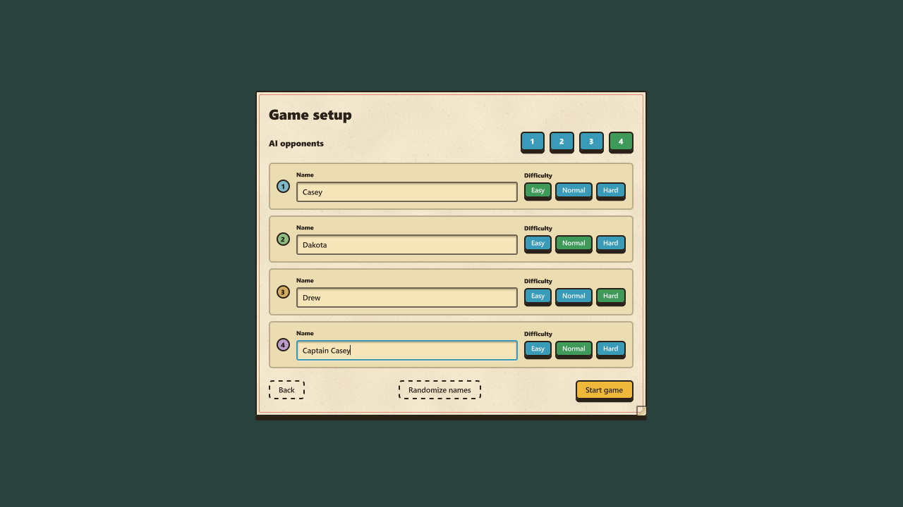
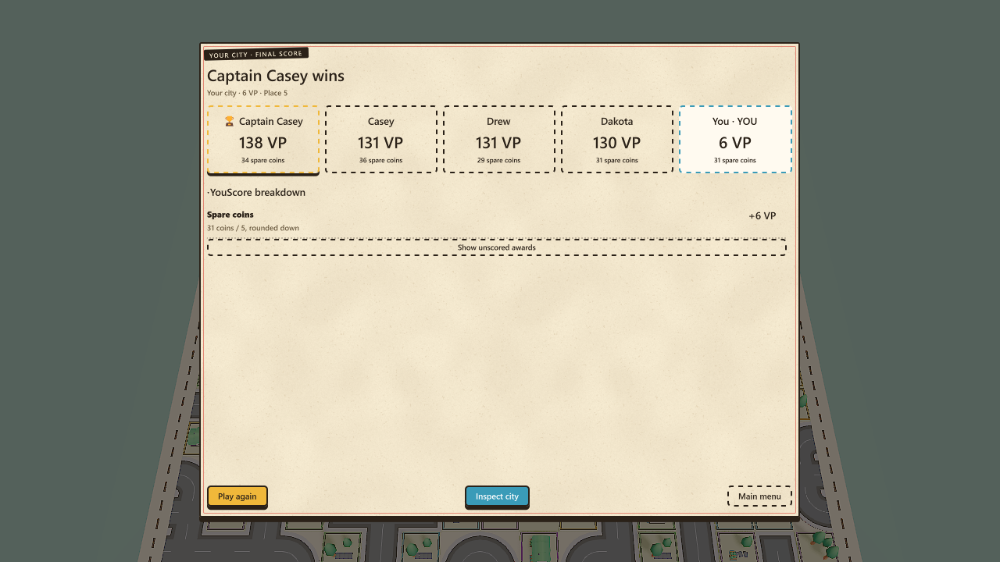

# Solo setup and AI redesign — 30 October 2026

Historical evidence from before balance 2026-10-30.4. See [the current placement and park balance pass](BALANCE_LOCAL_PLACEMENT_2026-10-30.md) for the replacement rules and fresh simulations.
Play now opens Game setup. Choose **one to four AI opponents**, edit each name, and select Easy, Normal or Hard independently. Solo supports up to five players; multiplayer remains limited to four humans.

## Setup and identity

- Back preserves edits. Reducing the count retains the hidden slots so adding them back restores their settings.
- Randomize names assigns four unique names and preserves difficulties. Names are limited to 24 characters; empty names receive a generated fallback when the match starts.
- Setup is saved through the engine's local cookies, separately from audio/display preferences. Invalid saved values are normalized.
- Start captures a separate roster. Opponent IDs, colours, names and difficulties remain stable during that match. Play again uses the saved setup.
- Names use their own random source. Renaming an opponent cannot change its gameplay decisions.
- The existing space-per-player formula produces 11×11, 13×13, 15×15 and 17×17 boards for one, two, three and four opponents.



## Decisions and difficulty

All difficulties use the same legal actions, prices, starting resources, placement rules and scoring rules. Planning sees public board state and the AI's own hand and contract. Rival hands, secret contracts, hidden draw order and future random events are excluded from planning snapshots.

| Difficulty | Payoff horizon | Candidate budget | Choice |
|---|---|---:|---|
| Easy | Up to 1.5 remaining payouts | 6 | Sometimes chooses another reasonable top candidate |
| Normal | Up to 3.5 remaining payouts | 10 | Chooses the highest evaluated action |
| Hard | All remaining payouts | 14 | Also searches continuations of the two best first moves using cards already held |

The evaluator accounts for recurring Street VP, Home/Shop and Farm placement, marginal park growth, current income, delayed/ramping income, public goals, its own contract progress, end-game card awards and competitions. Estimates cover future construction triggers, free cards and Hospital coverage. Shared effects include a small penalty for helping the strongest public rival. Uncertain future construction is discounted by available space and remaining time.

Cash is valued at the real five-coins-per-VP conversion, with a bounded early allowance for future purchases. Market cards are compared with passing, including their purchase cost and usable placements. AI can pass on poor purchases and retain blocked cards when it has room. Productive event timing and full-board renovations use the real rule methods.

Balanced, Housing, Trade, Nature, Industry and Culture preferences vary opponents. Four opponents receive distinct seeded preferences. The preference is a small tie-breaker; actual scoring and the available cards can change the resulting strategy. These are preferences, not six independently optimized policies.

Ordinary build pacing remains 2–4 seconds before the first action and 1.2–2.6 seconds between actions. Once the human empties their hand or readies, AI uses the shorter finish delay. Thinking can take longer when substantial planning remains. Delays shorten near the phase deadline.

## Planning and performance

Each planning step scans at most 64 sites or evaluates one candidate. Hard's continuation work resumes across later updates. The scheduler rotates its starting opponent and stops scheduling more opponents once the 4 ms group budget has been spent. That budget is soft: it cannot interrupt a running evaluation or garbage collection. A chosen move is checked against the live board before submission, since another player may have occupied its tile.

A native eight-round match with four Hard opponents completed on a 17×17 board using normal market/build timers and a shortened 0.5-second payout animation. The human readied without building. All four opponents completed 56 decisions each; there were **zero rejected actions**. Across 8,816 measured AI-group updates, p95 was **3.35 ms**, p99 **4.49 ms**, and maximum **13.37 ms**. Among updates taking at least 0.1 ms, p95 was 3.86 ms and p99 4.59 ms. This measures AI CPU time, not complete frame time or guaranteed performance on other hardware. A headless benchmark was also running on the machine.

Raw capture: [native profile](ai/2026-10-30-native-profile.json). The earlier [auction-era profile](AI_FRAME_PROFILE.md) is historical and uses different conditions.

## Simulation evidence

The [fresh old-AI baseline](ai/2026-10-30-before.json) contains 32 four-player matches across eight board seeds and rotating legacy strategies. It averaged 62.02 VP, 78.47 remaining coins and 50.58 coins spent per player. Industry Tag won 56.25% of matches. This captures the previous policy under the current card economy; it is not a human baseline.

The [new benchmark](ai/2026-10-30-benchmark.json) contains **96 completed matches** across four board seeds, all supported opponent counts, mixed difficulties and seat rotations. A Normal/Balanced bot represents the human seat; its results are excluded from the AI rows below. Each actor keeps its decision seed and style across its seat rotations. Simulation runs at 30 updates per second and checks eight payout curves, legal actions and purchase budgets. All 96 matches had **zero rejected actions and zero budget violations**.

| AI opponents | Difficulty | AI seats observed | Mean final VP | Mean remaining coins | Win share per observed AI seat |
|---:|---|---:|---:|---:|---:|
| 1 | Easy | 8 | 128.75 | 73.88 | 37.5% |
| 1 | Normal | 8 | 125.62 | 60.75 | 37.5% |
| 1 | Hard | 8 | 151.88 | 79.00 | 87.5% |
| 2 | Easy | 24 | 115.92 | 62.62 | 0.0% |
| 2 | Normal | 24 | 131.79 | 58.38 | 33.3% |
| 2 | Hard | 24 | 155.83 | 73.75 | 75.0% |
| 3 | Easy | 16 | 111.50 | 62.31 | 0.0% |
| 3 | Normal | 16 | 130.94 | 56.94 | 0.0% |
| 3 | Hard | 16 | 157.56 | 68.62 | 93.8% |
| 4 | Easy | 20 | 98.45 | 65.35 | 5.0% |
| 4 | Normal | 40 | 121.20 | 61.45 | 12.5% |
| 4 | Hard | 20 | 148.35 | 69.60 | 65.0% |

Hard consistently outperformed the Normal human proxy in this sample. Normal and Easy overlap in the small one-opponent sample; this does not establish separation in every matchup. Across all opponent counts, mean VP was Easy 111.25, Normal 126.26 and Hard 153.57. These aggregate rows have different matchup weights and are descriptive, not controlled estimates of difficulty effects. Rotated seats are correlated observations, with only four distinct board seeds.

Late cash remains substantial: overall remaining coins averaged 64.68/59.73/71.94 for Easy/Normal/Hard. Most available purchases were taken (about 23.6–23.9 per AI across 24 markets), so forcing more purchases would not solve the late surplus. The AI recognizes income and spending value, but the existing card economy still needs human feedback. No card prices or income amounts were changed in this redesign.

The new benchmark and old baseline use different player mixes, update rates and policy horizons. Their score difference is **not** a controlled before/after improvement estimate. Higher simulated scores and win rates do not prove that an opponent is fun. Human playtesting should assess pressure, variety, understandable choices, late coins and whether Hard feels too strong.

Reproduce the benchmark from the project folder:

```powershell
dotnet run --project tests/CitySim.Rules.Tests.csproj -- --ai-benchmark --boards 4 --seed 30102026
```

Progress goes to stderr; JSON goes to stdout. Timings vary between runs. Gameplay decisions and scores use seeded randomness; the existing deterministic match checks exclude wall-clock timing.

## Verification and requirement audit

| Requirement | Evidence |
|---|---|
| Play → setup → contract → match | Native button callbacks and contract/match state; [start capture](ai/2026-10-30-native-start.json) |
| 1–4 opponents; editable name and independent difficulty | Rendered four-row screen; native text insertion and separate Easy/Normal/Hard callbacks; setup checks |
| Random names, preserved edits, local persistence, frozen match roster | Native Randomize/Back/reopen/save/load and fresh play-session restart; [persistence capture](ai/2026-10-30-native-persistence.json); serialization and snapshot checks |
| Same rules and resources; privacy and replay | Public planning clone, rival-hand/name independence, budget/deadline checks, complete seeded match replay |
| Current scoring, contracts, events and combinations | Targeted Street/Full House/own-contract/cash/pass/renovation scenarios; Hard Street→Home continuation; finite legal planning scenario for all 48 cards |
| Four AI and five-player UI | 96-match benchmark covers all counts; native four-Hard match completed; five distinct colours and five visible market/result seats |
| Incremental fair planning and pacing | Scheduler/deadline/pacing checks, occupied-site revalidation, 18×18 stress match and native CPU capture |
| Build and rules regression | Game project builds with zero warnings/errors; 618 printed rule checks plus the analytics assertion group pass; [check log](ai/2026-10-30-rule-checks.txt) |

Native layout was inspected at the default 80% UI scale and maximum supported 120% scale. All four rows and footer actions fit in the tested editor viewport; the roster also supports scrolling. Captures are 1280×720 camera outputs from that viewport, not an exhaustive display/aspect-ratio test. Focus indices include all name fields; the background home controls are removed while setup is open. Physical keyboard/controller testing was not completed: direct computer-use access to the editor was not approved. Text insertion and action/focus bindings were exercised through the native editor APIs. A physical controller and broader aspect-ratio pass remain manual checks.

The editor was left open on the home screen, with the pre-test setup and UI scale restored. No publishing, remote push or asset deletion was performed for this redesign.


