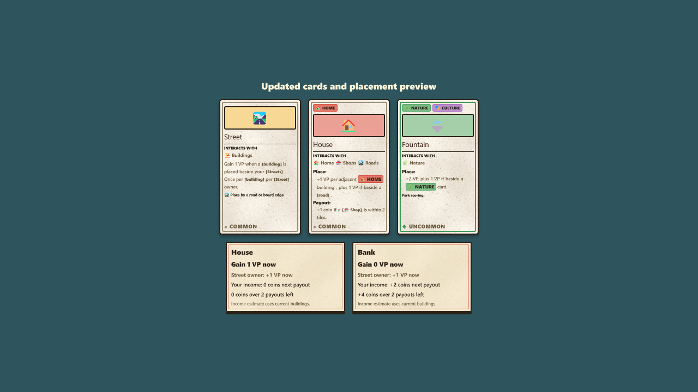

# Local placement balance pass — 30 October 2026

Implemented balance **2026-10-30.4**, GDD v0.12. This replaces the repeated Street scoring and shared park-size calculations seen in the two human playtests (seeds 382746 and 448196). The earlier [balance report](BALANCE_IMPLEMENTATION_2026-10-30.md) and [AI redesign report](AI_REDESIGN.md) describe the preceding version.

## Rules now implemented

### Streets and optional road bonuses

- When a non-road, non-event building is placed, each player owning an edge-adjacent Street receives **1 VP once**. Two Streets belonging to the same player still award that player only one point. Several different Street owners can each receive a point.
- The building can belong to anyone. Neutral city Streets have no player to reward.
- Placing a Street next to an existing building gives no retroactive award. Payouts and growth never repeat this award. Renovation is new construction under the existing renovation convention and triggers placement awards once for its new building; a repeated/stale request cannot repeat the action.
- House, Cafe, School, Museum, Hospital and Tourist Office receive **1 VP for their builder when placed beside any road**, including neutral roads, Avenue and Roundabout. This bonus does not stack with multiple roads. Existing House/Home adjacency and other card effects remain separate.
- A player who builds their House beside their own Street receives both awards: 1 road-adjacency VP and 1 Street-owner VP, in addition to any Home adjacency VP.

Fourteen cards no longer require roads: House, Housing Authority, Farm, Orchard, Vineyard, Eco Council, Cafe, School, Museum, Hospital, Tourist Office, Startup, Contractor and Architect's Studio. Fifteen of the 40 building cards still require roads. Street's own connection-to-road-or-board-edge rule remains in force.

### Parks

| Card | Base VP when placed | Additional award |
|---|---:|---|
| Park, Wild Garden, Orchard, Lake | 1 | +1 VP if beside any Nature-tagged card |
| Fountain | 2 | +1 VP if beside any Nature-tagged card |
| Sapling | 1 | +1 VP if beside Nature; +2 VP once after its second payout |

The Nature bonus uses edge adjacency, any owner, and at least one other Nature card. It never counts the new card itself, never stacks, and never retroactively rewards existing parks. Farm, Vineyard, Eco Council and other Nature-tagged buildings qualify even if they are not park tiles.

There is no park-size calculation, rounded division or shared scoring cap. Lake connects park regions and qualifies for park interactions and goals. Every park card is one physical tile, including Fountain and mature Forest. The final Biggest Park Owner competition and Green Thumb continue to count owned physical tiles within a connected shared park; their point rewards are unchanged.

### Clarity and previews

- Card descriptions, timing sections, interaction highlights, park help, catalog and CSV reflect the new rules. Growth and Each round have separate timing labels.
- Industrialist explicitly requires **Industry-tagged** buildings. Farms and Orchards retain Nature tags; their internal production card type does not count toward Industry objectives. The catalog calls their category Farming.
- A live placement preview shows the builder's immediate VP, other players' immediate VP, immediate coin awards, the change to the next payout, projected payout coins over the remaining rounds, and changes to end-game card bonuses.
- Income forecasts use the current surrounding buildings. They include delayed/ramping income and subtract the removed building's income during renovation. They exclude future construction, purchases, random emergencies and growth VP; Sapling's growth award is printed separately on its card.
- Feedback displays the total park placement award once and displays rival Street-owner awards. The underlying placement awards are recorded in local analytics.

The AI evaluates the real new placement rules, fixed Forest growth and existing legal placements. Its old recurring Street value and weighted park-growth estimate have been removed. It uses a small, space-limited estimate for future construction beside Streets, rather than rewarding buildings already present.

## Verification

The game project builds with **zero warnings and errors**. The complete pure rule suite passes **655 printed checks**, plus the analytics assertion group. New coverage includes multiple roads/owners, neutral and diagonal roads, same-owner double bonuses, no retroactive Street score, repeated payouts, all fourteen relaxed road requirements, any-owner Nature adjacency, non-stacking bonuses, large parks, Lake connectivity, fixed Forest growth, pure previews and late-income/renovation forecasts. Existing network authority, replay, checkpoint, deadline and pacing checks also pass.

The running editor independently verified a House awarding 1 VP to its builder and 1 VP to the Street owner, with no extra Street VP at payout. A Fountain beside a rival Farm awarded 3 VP. The actual card and preview components were rendered in a temporary fixture overlay; the overlay was removed without changing the user's screen or match.



Evidence: [rules](balance/local-placement-2026-10-30/rule-checks.txt), [build](balance/local-placement-2026-10-30/build.txt), [native rules and catalog](balance/local-placement-2026-10-30/native.json), [source fingerprints](balance/local-placement-2026-10-30/source-sha256.json).

## Fresh simulations

Ran **96 eight-round matches** over four board seeds, every supported opponent count (1–4), mixed difficulties and seat rotations. The human seat is represented by a Normal/Balanced proxy. A second run reproduced all 96 match outcomes exactly, including purchases, score curves and final card ownership; timing measurements naturally differ. Both runs recorded **zero rejected actions and zero budget violations**.

| Difficulty | AI seats observed | Mean final VP | Mean Street-owner VP | Mean park placement/growth VP | Mean building road-bonus VP | Mean final coins |
|---|---:|---:|---:|---:|---:|---:|
| Easy | 68 | 76.34 | 2.79 | 20.53 | 6.31 | 69.74 |
| Normal | 88 | 76.11 | 2.16 | 23.12 | 5.36 | 71.11 |
| Hard | 68 | 78.32 | 6.69 | 16.94 | 5.09 | 98.99 |

The maximum Street-owner award total for any seat was **16 VP**. AI final Street ownership averaged 1.65/1.35/3.31 for Easy/Normal/Hard, rather than the 9–16 Streets seen among the opponents in the first human playtest. All six style preferences appeared among match winners across the complete field, including the Normal/Balanced proxy. This indicates that the previous Street strategy no longer dominates this sample; it does not prove equal strategy strength.

Individual headless update p99 stayed at or below 1.19 ms in every match, while the largest individual update took 47.99 ms. These are soft scheduling measurements, include idle/delayed work in the full distribution, and do not establish a guaranteed frame budget or a native full-match CPU profile for this balance version.

Raw data: [96-match benchmark](balance/local-placement-2026-10-30/benchmark.json). Command:

```powershell
dotnet run --project tests/CitySim.Rules.Tests.csproj -- --ai-benchmark --boards 4 --seed 30102026
```

## Remaining tuning questions

Four board seeds and correlated seat rotations are a small balance sample. Easy, Normal and Hard now overlap substantially; Hard does not consistently beat the Normal proxy in every opponent-count group. Aggregate means have different matchup weights. More human games are needed to tune difficulty and playing preferences against the simpler scoring.

Late coins remain plentiful, particularly for Hard. Prices, income amounts and five-coins-per-end-VP conversion were not changed in this pass. The new previews make poor late income purchases visible, but do not solve the economy by themselves. Further coin changes should use fresh human recordings under version .4.

No publish, push, asset deletion or multiplayer-capacity change was performed.
